# Segmentation Model UI — 탭별 사용 순서 가이드

이 문서는 **학습 탭 · 추론 탭(main 브랜치)**, **Top/Bottom Analysis(존) 탭 · R Analysis 탭(edition 브랜치 `feature/zone-analysis-tab` 전용)** 을
사용자가 실제로 버튼을 누르는 순서 그대로 정리한 가이드다. 각 탭마다 실제 화면 스크린샷, 분기(결정 지점)를 표시한
흐름도(Mermaid), 추천 파라미터/설정 표를 담았다.

> 기존 [`USER_MANUAL.md`](../USER_MANUAL.md)/[`USER_MANUAL_ZONE.html`](../USER_MANUAL_ZONE.html)는 설치·프로젝트 시스템·단축키 등을 포괄하는
> 전체 레퍼런스 매뉴얼이고, 이 문서는 "4개 핵심 탭을 어떤 순서로 클릭해야 하는가"에 집중한 작업 순서 가이드다. 서로
> 대체하지 않고 보완한다.

## 목차

1. [학습 탭](#1-학습-탭) (main)
2. [추론 탭](#2-추론-탭) (main)
3. [Top/Bottom Analysis (존 분석) 탭](#3-topbottom-analysis-존-분석-탭) (edition: `feature/zone-analysis-tab`)
4. [R Analysis 탭](#4-r-analysis-탭) (edition: `feature/zone-analysis-tab`)

---

# 1. 학습 탭

학습 탭은 "모델이 로드되어 있다"는 전제로 동작한다. 아래 순서는 실제로 버튼을 누르는 순서 그대로다.

## 1단계 — 모델 탭에서 모델 로드 확인

학습을 시작하려면 **모델 탭**에서 `nn.Module` 코드가 먼저 로드되어 있어야 한다. 직접 코드를 붙여넣거나, `AI 모델 프리셋…` 버튼으로 제공된 베이스라인(U-Net, DeepLab 등)을 불러올 수 있다.

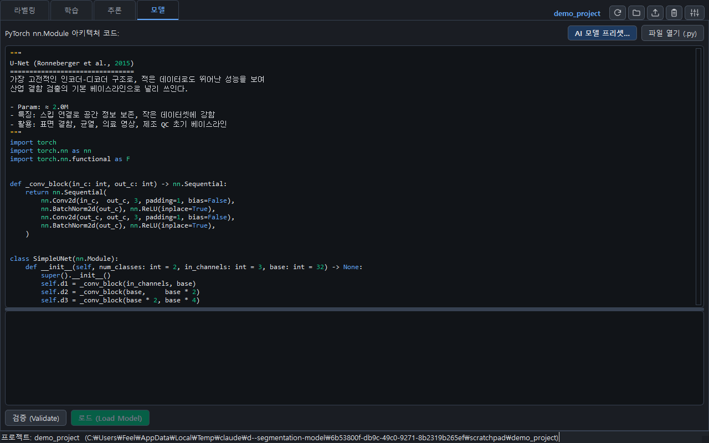

`검증 (Validate)` 버튼을 눌러 코드가 안전한 `nn.Module` 서브클래스인지 AST로 확인한다. 통과하면 로그에 `[OK] 검증 통과`가 뜨고 `로드 (Load Model)` 버튼이 활성화된다.

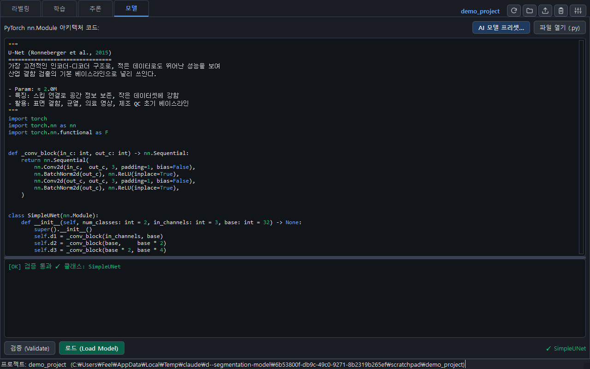

`로드 (Load Model)` 버튼을 누르면 실제로 모델 인스턴스가 생성되고 파라미터 수가 표시된다. 이 상태가 되어야 학습 탭에서 "현재 로드된 모델"을 작업에 쓸 수 있다.

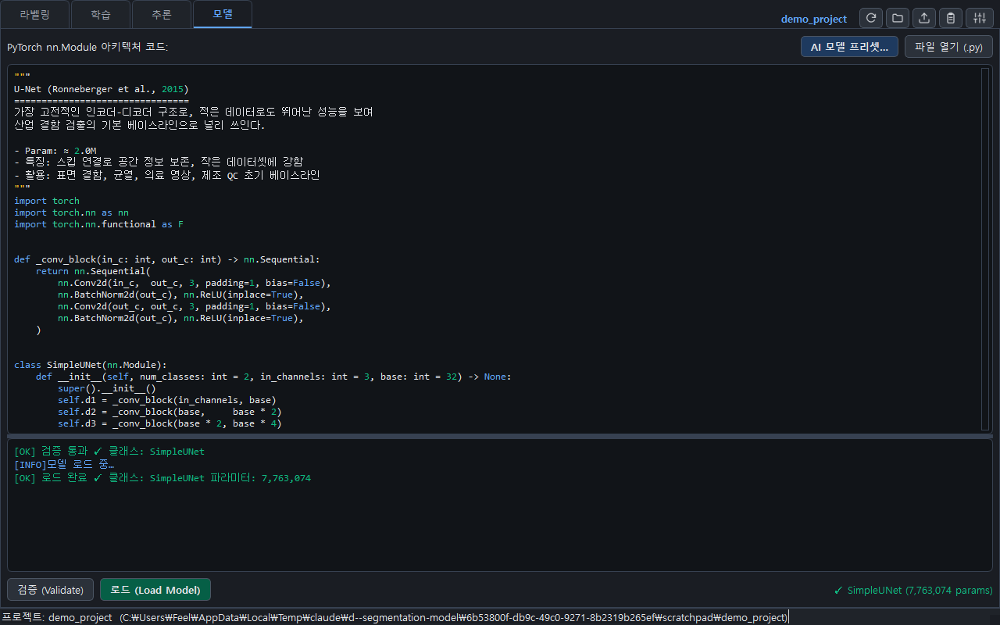

## 2단계 — 학습 탭 진입 후 하이퍼파라미터 설정

학습 탭 왼쪽 패널에서 이미지 샘플링 방식, 데이터, 학습, 옵티마이저, 스케줄러를 순서대로 설정한다. 상단 CUDA 배너는 진단이 끝나면 자동으로 GPU 유무를 표시한다(여기서는 `CUDA  NVIDIA GeForce RTX 5060`).

- **이미지 샘플링**: 대형 원본은 `random_crop`(패치 학습) 권장, 소형 이미지나 빠른 테스트는 `resize`.
- **학습**: Epochs / Batch Size / Learning Rate / 체크포인트 저장 주기.
- **옵티마이저**: Adam/AdamW/SGD/RMSprop + Weight Decay + Momentum(SGD 전용).
- **손실 함수 / 장치**: CrossEntropy / Dice / Focal 중 선택, Device(auto 권장), Mixed Precision(AMP).
- **LR Scheduler**: 기본값은 `ReduceLROnPlateau`(자동·범용) — 상황별 추천은 아래 표 참고.

## 3단계 — 작업 이름 입력 후 큐에 추가

작업 이름을 입력하고(비워두면 자동 번호 부여), 사용할 모델("현재 로드된 모델" 또는 프리셋)을 고른 뒤 `큐에 추가` 버튼을 누른다. 여러 설정을 비교하고 싶다면 이름을 바꿔가며 여러 번 추가해 큐에 쌓을 수 있다.

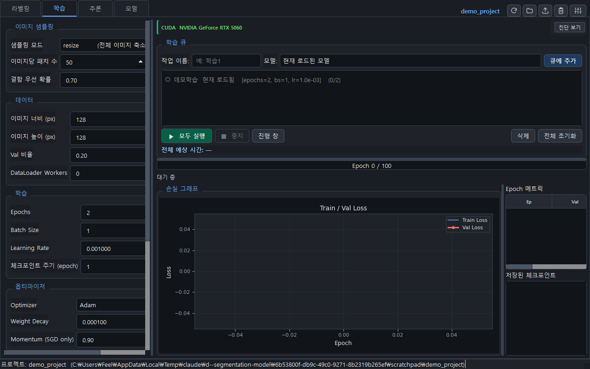

## 4단계 — 모두 실행

`모두 실행` 버튼을 누르면 큐의 대기 작업을 순서대로 실행한다.

> **분기 — GPU 사용 불가 시**: 이 PC에 CUDA GPU가 없거나 초기화에 실패하면, 학습을 시작하기 전에 진단 결과와 함께 "CPU 로 진행하시겠습니까?" 확인 팝업이 뜬다. `CPU 로 진행`을 누르면 계속 진행하고, `취소`를 누르면 큐 실행이 중단된다. (GPU가 있는 환경에서는 이 분기가 뜨지 않고 바로 다음 단계로 진행된다.)

버튼을 누르면 비모달 **학습 진행 팝업**(현재 작업 Epoch/ETA, 큐 전체 상태, 단계별 로그)이 함께 뜬다.

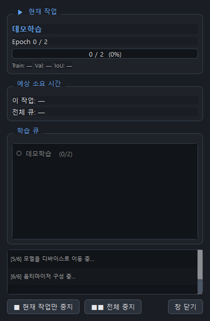

학습 탭 본문에서도 동일한 정보(Epoch 진행바, Step 카운터, 실시간 손실 그래프, 우측 메트릭/체크포인트 패널)를 확인할 수 있다.

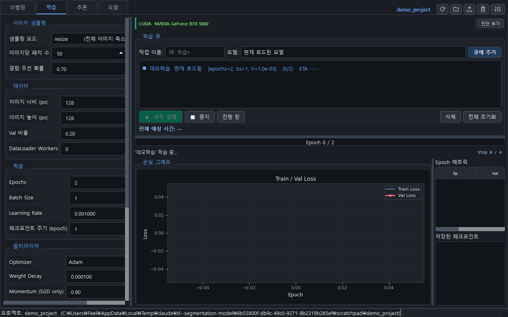

> **분기 — 중지 버튼**: 학습 도중 `중지` 버튼을 누르면 "전체 큐를 중지하시겠습니까?" 확인 다이얼로그가 뜬다. `Yes`(전체 중지), `No`(현재 작업만 중지하고 다음 큐로 진행), `Cancel`(아무 것도 하지 않고 계속 학습)의 3가지 선택지가 있다.

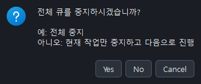

## 5단계 — 학습 완료 / 체크포인트 저장

설정한 에폭을 모두 마치면 상태가 "모든 학습 완료"로 바뀌고, 손실 그래프에 Train/Val Loss 전체 곡선이 그려지며, 우측에 에폭별 Val/IoU 메트릭과 저장된 체크포인트 목록(`*_best.pt`, `*_epoch_NNNN.pt`)이 쌓인다.

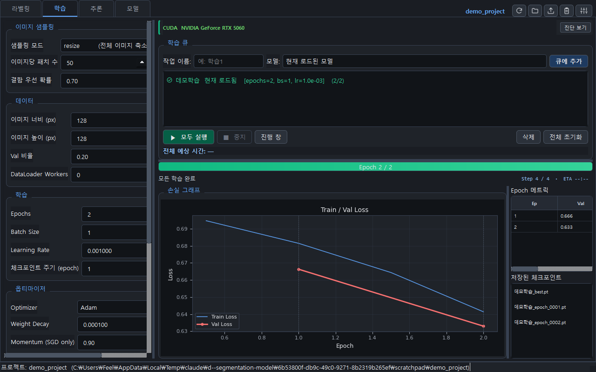

## 전체 흐름

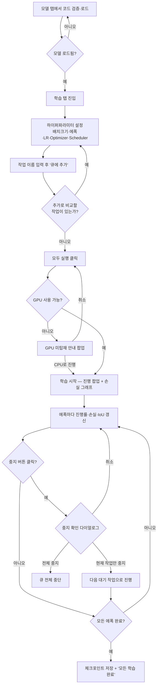

## 추천 파라미터 / 설정

| 항목 | 코드 기본값 | 추천값 / 가이드 |
|---|---|---|
| 이미지 샘플링 모드 | `random_crop` | 대형 원본(수십 MB급) → `random_crop`, 소형/테스트용 → `resize`. `center_crop`은 검증 일관성 전용 |
| 패치 수 (patches_per_image) | 50 | 대형 이미지(≈50MB급) 50~100. `자동 계산` 버튼으로 IMG SIZE 대비 40% 커버리지 권장값 산출 가능 |
| 결함 우선 샘플링 확률 | 0.7 | 결함이 드문 데이터일수록 0.7~0.9로 올려 클래스 불균형 완화 |
| Epochs | 50 | 베이스라인 탐색 20~50, 본 학습은 Early stopping/Plateau와 함께 100+ |
| Batch Size | 4 | GPU 메모리에 맞춰 4~16. OOM 시 절반으로 감소 |
| Learning Rate | 1e-4 | Adam/AdamW 계열 1e-4~3e-4, SGD는 1e-2~1e-3 + momentum 0.9 |
| Val Split | 0.2 | 데이터가 매우 적으면(≤10장) 0.1~0.2, 이미지 단위로 분할됨(패치 유출 없음) |
| DataLoader Workers | 0 | 기본 0(가장 안전). 올릴 경우 **상한 2 권장** — Windows에서 3~4는 페이징 파일 부족으로 OSError/MemoryError 재현. num_workers=2 + persistent_workers 기준 9~13ms/batch(20~30배 개선) |
| Optimizer | Adam | 일반적으로 Adam/AdamW 무난, 세밀한 수렴 제어가 필요하면 SGD+momentum 0.9 |
| Weight Decay | 1e-4 | 산업용 결함 검출의 약한 정규화 기본값. 데이터 충분 시 0, 극소 데이터는 0.01 |
| Loss Function | CrossEntropyLoss | 일반적인 경우 CE, 결함 영역이 작으면 DiceLoss, 결함이 매우 드물면 FocalLoss |
| Mixed Precision (AMP) | 켜짐 | GPU 메모리 ~50% 절약 + 1.5~3배 속도 향상. CC<7.0(Maxwell/Pascal) GPU는 자동 비활성화 |
| LR Scheduler | **ReduceLROnPlateau**(기본값) | 상황별 추천: 단순·안정 → **StepLR**, 빠른 감소 → **ExponentialLR**, ViT/UNet 표준 → **CosineAnnealingLR**, 더 좋은 최솟값 탐색 → **CosineWarmRestarts(SGDR)**, 자동·범용(기본) → **ReduceLROnPlateau**, 빠른 수렴·LR 탐색 불필요 → **OneCycleLR**, 대형 모델·배치 → **WarmupCosine**, FCN/DeepLab 계열 원논문 재현 → **PolynomialLR**(power 0.9) |
| Checkpoint 저장 주기 | 5 epoch | 짧은 실험은 1, 본 학습은 5~10 (디스크 용량 고려) |

---

# 2. 추론 탭

추론 탭은 학습된 체크포인트로 새 이미지에 세그멘테이션을 실행하고, 결과를 시각적으로 확인·필터링·내보내는 화면이다. 아래 순서는 실제 버튼 배치를 따른 골든 패스다.

## 1. 체크포인트 선택

추론 탭을 열면 학습 탭에서 저장된 체크포인트 목록이 표에 자동으로 뜨고, **가장 최근 체크포인트가 자동으로 선택**된다. 다른 체크포인트를 쓰려면 표에서 행을 클릭하면 된다. 선택 즉시 해당 체크포인트가 어떤 모델로 학습됐는지(`U-Net`, `DeepLabV3` 등) 표 아래 라벨에 자동으로 표시된다 — 프리셋 모델이면 바로 추론 준비가 끝나고(초록색 "자동 준비됨"), 모델 탭에서 직접 작성한 아키텍처로 학습한 체크포인트라면 모델 탭에 같은 코드를 먼저 로드해야 한다는 안내(노란색)가 뜬다.

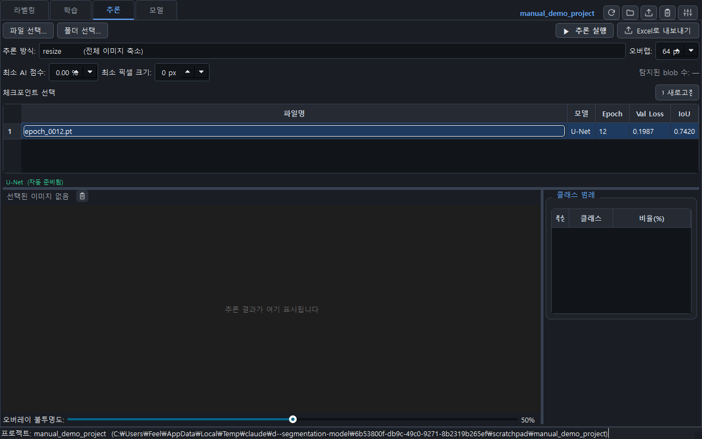

## 2. 추론할 이미지 선택

**파일 선택** 버튼으로 이미지 1장 이상을 직접 고르거나, **폴더 선택** 버튼으로 폴더 전체(하위 폴더 포함, 재귀 스캔)를 불러온다. 이미지가 2장 이상이면 왼쪽에 검색·정렬이 되는 이미지 목록 패널과 이전/다음 탐색 버튼이 나타난다(단일 파일이면 이 패널은 숨김).

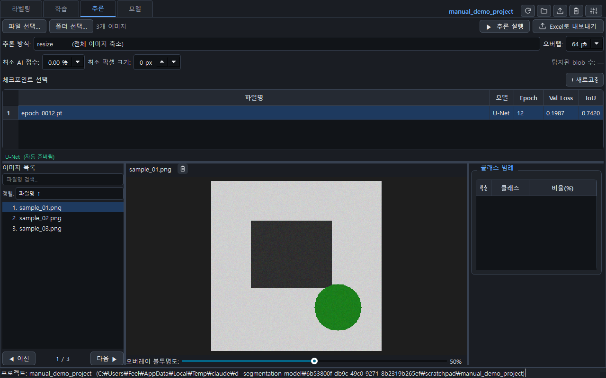

## 3. (선택) 추론 옵션 조정

실행 전에 아래 옵션을 상황에 맞게 조정한다.

- **추론 방식**: `resize`(이미지 전체를 축소해 한 번에 추론, 기본값) 또는 `sliding_window`(원본 해상도를 패치로 겹쳐가며 추론 후 병합 — patch 단위로 학습한 모델이나 고해상도 원본의 세밀한 경계가 필요할 때).
- **오버랩**: `sliding_window` 선택 시에만 의미 있음 — 패치 간 겹치는 픽셀 수.
- **최소 AI 점수 / 최소 픽셀 크기**: 추론 결과에서 신뢰도나 크기가 작은 blob(연결 영역)을 배경으로 지우는 threshold. 추론 실행 전에 미리 설정해도 되고, 실행 후 결과를 보면서 바로 바꿔도 된다(5~6단계 참고 — 모델 재실행 없이 즉시 재계산됨).

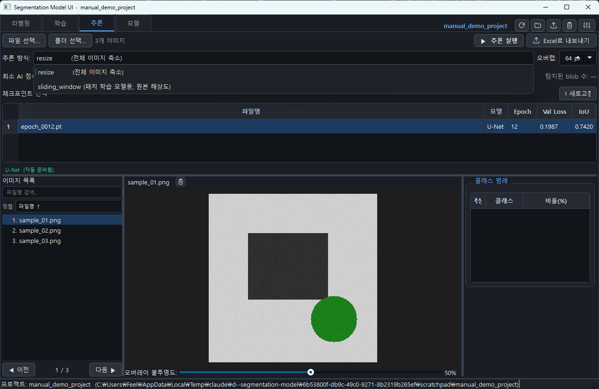

## 4. 추론 실행

**▶ 추론 실행** 버튼을 누르면 선택된 모든 이미지(목록 전체)에 대해 한 장씩 순차 추론이 시작된다. 버튼이 "추론 중…"으로 바뀌고 진행률 바에 `완료수 / 전체수`가 실시간으로 올라간다. 체크포인트 표의 행을 더블클릭해도 같은 동작을 바로 실행할 수 있다.

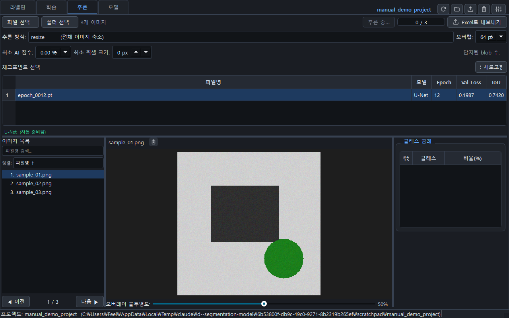

## 5. 오버레이 결과 확인

완료되면 선택된(또는 첫) 이미지에 원본+클래스별 색상 마스크가 블렌딩되어 표시된다. 오른쪽 범례에서 클래스별 색상과 픽셀 비율(%)을, 오른쪽 위에서 탐지된 blob 총수를 확인할 수 있다. `F` 키로 오버레이 표시를 즉시 켜고 끌 수 있다(검출 전/후 비교용).

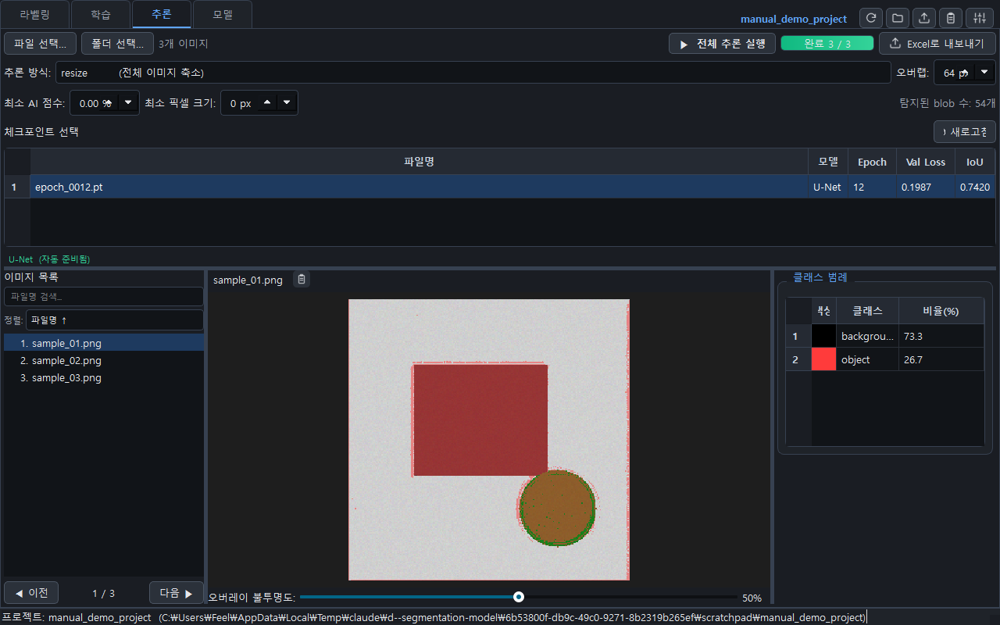

## 6. (분기) 오버레이 불투명도 재조정

하단 슬라이더로 불투명도를 바꾸면 **모델을 다시 돌리지 않고** 기존 결과를 즉시 재블렌딩해서 보여준다(약 75ms 디바운스). 원본 디테일을 더 보고 싶으면 낮추고, 마스크 경계를 또렷이 보고 싶으면 높인다.

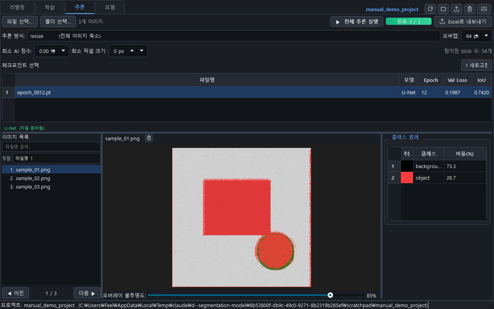

## 7. (분기) 최소 AI 점수 / 최소 픽셀 크기 재조정

상단의 "최소 AI 점수"나 "최소 픽셀 크기" 값을 바꾸면 **모델을 다시 돌리지 않고** numpy/OpenCV 연산만으로 즉시 재필터링한다(약 150ms 디바운스). 예시 화면은 최소 픽셀 크기를 50px로 올려 작은 노이즈성 blob(speckle)들을 제거해 blob 수가 크게 줄어든 모습이다.

## 8. (분기) 폴더 모드 — 이전/다음 이미지 탐색

이미지를 2장 이상 불러온 경우, **이전 ◀ / 다음 ▶** 버튼이나 왼쪽 목록 클릭으로 다른 이미지로 이동할 수 있다. 이미 일괄 추론이 끝났다면 재계산 없이 해당 이미지의 결과가 바로 표시된다.

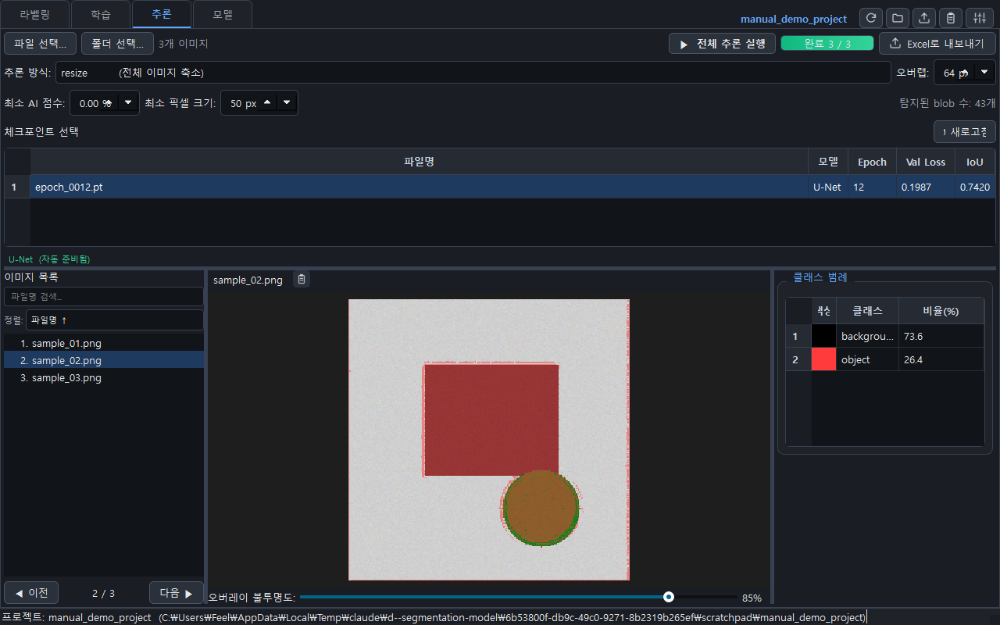

## 9. (분기) Excel로 내보내기

**Excel로 내보내기** 버튼을 누르면, 폴더 모드(이미지 2장 이상)일 때는 "현재 이미지만" 내보낼지 "목록 전체 일괄 추론" 후 모두 내보낼지 선택하는 창이 뜬다(단일 이미지 모드거나 "현재 이미지만"을 고르면 바로 저장 경로를 묻는다). 각 blob의 클래스·픽셀 수·신뢰도·중심좌표·bbox가 시트 하나로 정리되어 저장된다.

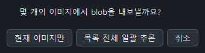
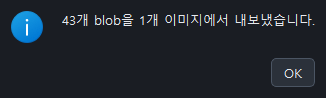

## 전체 흐름

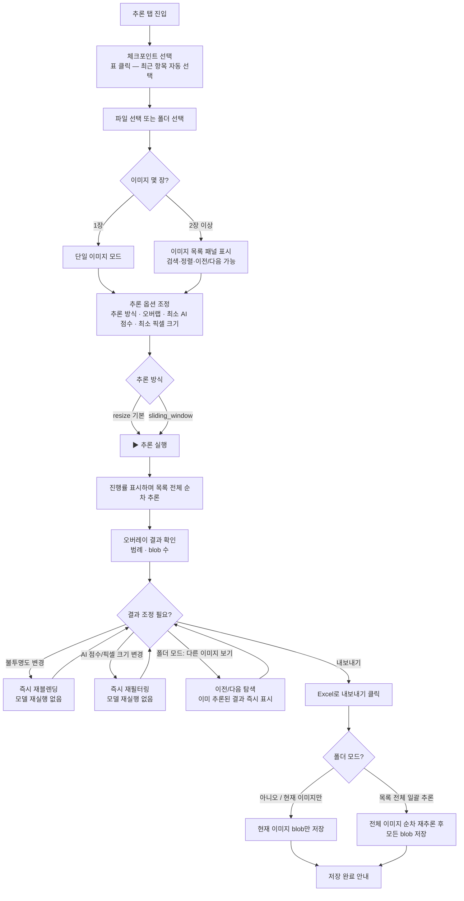

## 추천 파라미터 / 설정

| 설정 | 코드 기본값 | 실무 권장 | 주의사항 |
|---|---|---|---|
| 추론 방식 | `resize` (전체 이미지 축소) | 대부분 `resize` 그대로 사용 | `random_crop`/패치 단위로 학습한 모델이거나 원본 해상도의 세밀한 경계가 중요하면 `sliding_window`로 전환 — 연산량이 늘어난다 |
| 오버랩(sliding_window) | 64px (범위 0~256) | 기본 64px 유지 또는 patch_size의 10~25% | 너무 작으면 패치 이음새가 어색하게 보이고, 너무 크면 추론 시간이 비례해서 늘어난다 |
| 최소 AI 점수 | 0% (범위 0~100%) | 실데이터에서는 40~60%부터 시작해 노이즈 blob을 걸러내며 조정 | 0%는 신뢰도가 아주 낮은 오탐 blob까지 그대로 보여준다. 80% 이상으로 너무 높이면 실제 결함을 놓칠 수 있다 |
| 최소 픽셀 크기 | 0px (범위 0~100000) | 예상되는 최소 결함 크기의 절반 정도 값으로 시작(예: 최소 결함이 20px²면 10px) | 0px는 1픽셀짜리 노이즈까지 blob으로 집계한다. 과하게 높이면 작은 실제 결함도 함께 사라진다 |
| 오버레이 불투명도 | 50% | 평상시 50% 유지, 경계 확인 시 70~90%, 원본 질감 확인 시 20~30% | `F` 키로 오버레이 전체를 즉시 토글할 수 있어 양 극단(0%/100%) 대신 그걸 활용해도 된다 |

---

# 3. Top/Bottom Analysis (존 분석) 탭

> edition 브랜치(`feature/zone-analysis-tab`) 전용 기능 — 배터리 캡 녹(rust) 검사 전용 도구.

AI 모델이 자동으로 녹을 검출하면, 사용자가 브러시로 그 결과를 직접 보정한다. **브러시로 그리거나 지운 영역은 AI 검출 영역과 화면상 완전히 동일한 색·불투명도로 표시된다** — 브러시 보정은 별도 색으로 덧칠하는 게 아니라 "AI가 검출한 것과 같은 대상을 고치는 도구"로 취급되기 때문이다. 드래그 중인(아직 확정 전) 스트로크만 임시로 파란색(그리기)/회색(지우기)으로 보이고, 손을 떼는 순간(release) 검출 색으로 즉시 통일된다.

화면 상단의 7단계 인디케이터(① 체크포인트 → ② 이미지 → ③ 영역 설정 → ④ 추론 실행 → ⑤ 진행상황 → ⑥ 결과 보정 → ⑦ 결과 분석)는 강제 위저드가 아니라 **현재 진행 상황을 보여주기만 하는 참고용 표시**다. 아무 단계나 건너뛰거나 되돌아갈 수 있다.

## 1. 체크포인트 열기

좌상단 **"체크포인트 열기 (.pt)"** 버튼으로 학습된 모델 체크포인트(`.pt`)를 연다. 프리셋 모델로 학습된 체크포인트면 모델 구조가 자동으로 준비되고(초록 점 + "자동 준비됨" 표시), 출처를 알 수 없는 체크포인트면 하단에 커스텀 모델 코드 입력 박스가 나타난다.

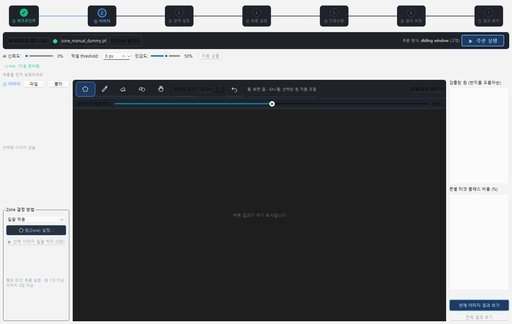

## 2. 이미지(또는 배치) 불러오기

좌측 패널의 **"파일"**(다중 선택 가능) 또는 **"폴더"**(하위 폴더까지 재귀 스캔) 버튼으로 이미지를 불러온다. 2장 이상이면 좌측에 이미지 목록이 나타나고, 목록에서 클릭해 작업할 이미지를 전환할 수 있다.

## 3. 영역(Zone) 설정 — 동심원

존 퍼센티지는 "동심원 몇 개가 이미지를 몇 개의 고리(zone)로 나누는가"를 기준으로 계산된다. 이미지를 불러온 직후(추론 전에도) 바로 설정할 수 있다.

### 3-1. 자동 검출

**"자동 검출"** 버튼을 누르면 이미지에서 동심원 후보를 찾는다. 옆의 **민감도** 슬라이더(기본 50%)를 올리면 더 약한 edge도 후보로 받아들인다.

**분기 — 검출 실패:** edge가 뚜렷하지 않은 이미지(예: 평평한 금속면)에서는 "원을 찾지 못했습니다. 민감도를 조절하거나 수동으로 추가하세요." 안내가 뜬다.

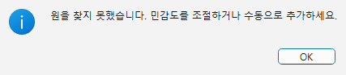

이 경우 캔버스에 직접 **클릭+드래그**해서 원을 수동으로 그린다. 두 번째 원부터는 중심이 "기존 원들의 평균 중심"으로 자동 강제된다(배터리 캡은 항상 동심원이라는 전제). 원을 선택한 뒤 Delete로 삭제, 우클릭 메뉴로 지름/이름 변경, 방향키로 미세 이동(Shift=10px), Alt+휠로 반지름 조절도 가능하다.

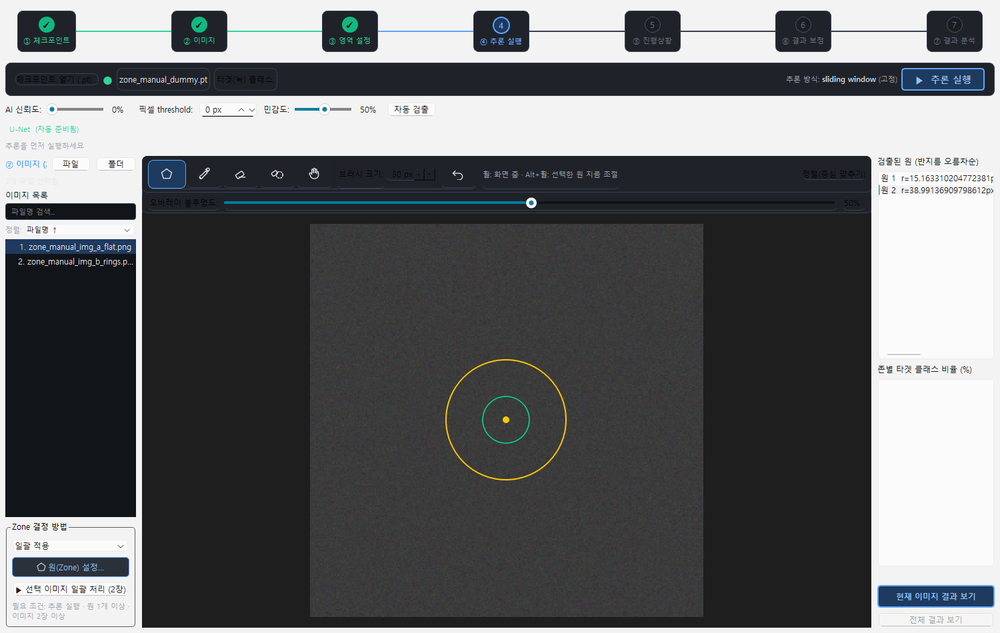

**분기 — 검출 성공:** 동심원 윤곽이 뚜렷한 이미지(배터리 캡 등)에서는 자동으로 원이 그려진다.

## 4~5. 추론 실행 / 진행상황

영역 설정이 끝나면(또는 건너뛰어도 — 원이 없으면 확인 팝업 후 진행 가능) **"▶ 추론 실행"**을 누른다. GPU를 쓸 수 없는 환경이면 CPU로 계속할지 묻는 진단 팝업이 뜬다. 여러 이미지를 불러온 상태라면 전체에 대해 순차 추론하며 진행 바가 표시된다.

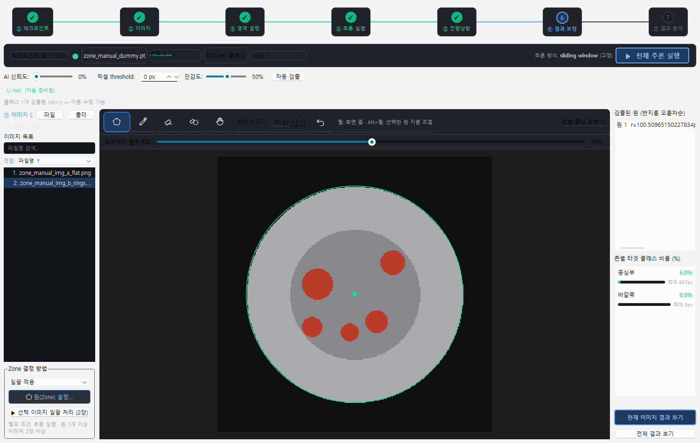

검출된 클래스가 여러 개면 드롭다운에서 타겟(녹) 클래스를 고른다. **AI 신뢰도** 슬라이더와 **픽셀 threshold** 스핀박스로 재추론 없이(numpy 연산만으로) 즉시 필터링 결과를 바꿀 수 있다.

## 6. 결과 보정

### 6-1. 오버레이 불투명도 / 표시 토글

캔버스 상단 **오버레이 불투명도** 슬라이더로 검출 색의 진하기를 조절한다(이미지 전환·재추론에도 값 유지).

**F 키**(캔버스에 포커스가 있을 때)로 오버레이를 켜고 끌 수 있다 — 원본 사진과 비교할 때 유용하다.

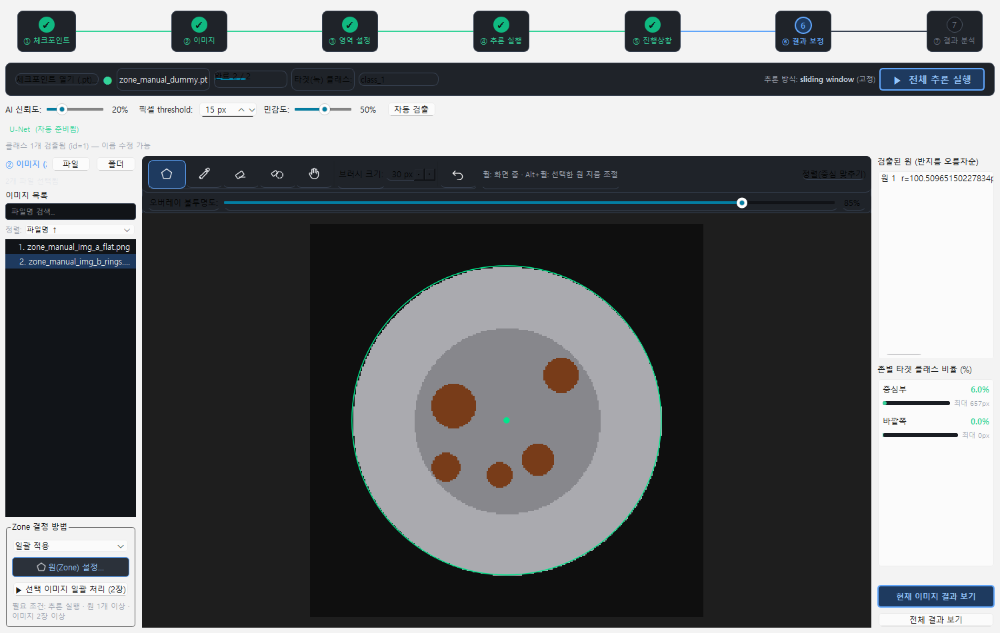
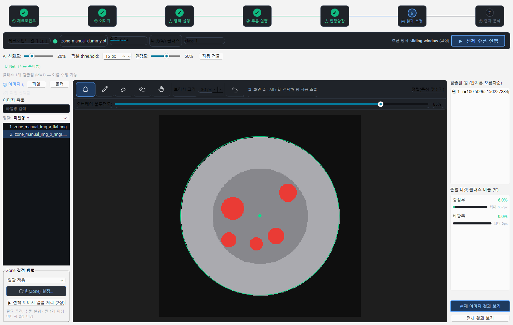

### 6-2. 브러시로 그리기 / 지우기

상단 보조 툴바에서 도구를 고른다(라벨링 탭과 같은 브러시 클러스터 — 그리기 / 지우개 / 영역삭제(블랍삭제) / Pan / 실행취소 / 브러시 크기). 이미 선택된 도구를 다시 클릭하면 토글 해제되어 원(circle) 편집 모드로 돌아간다.

**브러시로 그리기** — AI가 놓친 녹 영역을 수동으로 추가한다. 커밋되는 즉시(마우스를 떼는 순간) 그 영역이 AI 검출 영역과 **완전히 같은 색·같은 불투명도**로 칠해진다(드래그 중에만 파란색 미리보기).

**브러시로 지우기** — AI가 잘못 검출한 영역을 수동으로 제거한다. 커밋되면 그 영역은 회색 틴트가 남는 게 아니라 **원본 이미지 픽셀 색 그대로** 돌아간다(아래 스크린샷에서 지워진 부분에 원래 그려둔 녹슨 갈색이 그대로 드러난다 — 빨간 틴트만 제거되고 원본 색은 보존된다는 증거).

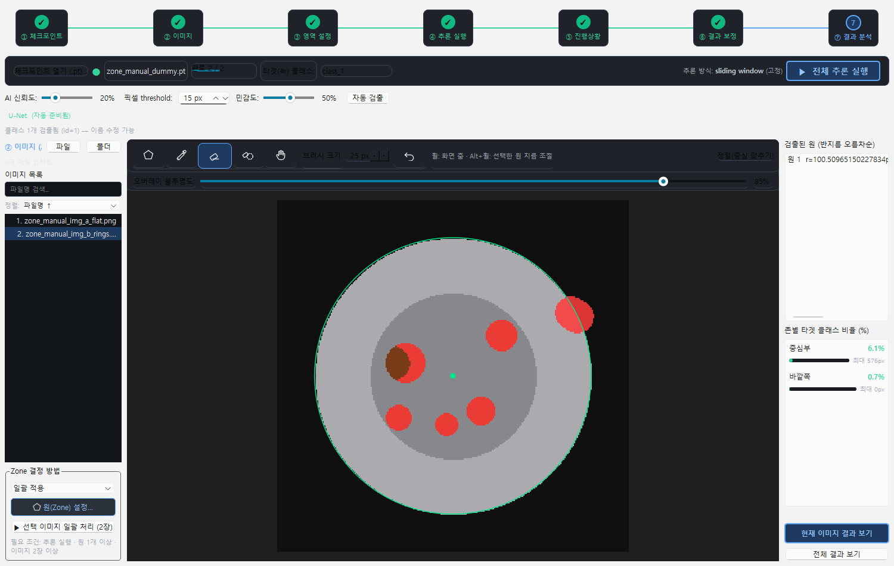

### 6-3. 블랍 삭제 모드

"영역삭제" 도구(블랍 삭제 모드)를 선택하고 블랍을 클릭하면 그 연결영역 전체가 한 번에 제거된다. 제거된 블랍은 빨간 바운딩 박스로 표시된다(모양이 아니라 bbox 근사 — 의도적 단순화).

### 6-4. 실행 취소(Undo)

원 편집·블랍삭제·브러시 그리기/지우기는 **하나의 통합 Undo 스택**에 쌓인다. 상단 툴바의 되돌리기(↶) 버튼 또는 `Ctrl+Z`로 바로 직전 동작 하나만 되돌린다.

## 7. 결과 분석

우측 패널의 **존 리스트**에서 각 zone(중심부/바깥쪽 등)의 타겟 클래스 비율(%)과 해당 zone 안 최대 blob 픽셀 수를 바로 확인할 수 있다. 행을 클릭하면 캔버스에서 해당 zone이 노란색으로 하이라이트된다.

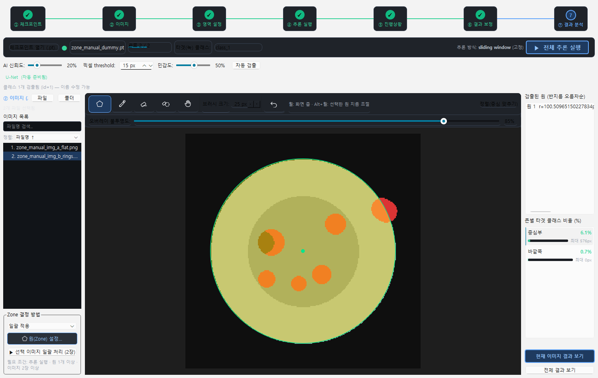

**"현재 이미지 결과 보기"** 버튼으로 지금 화면의 존별 비율을 표로 보고 Excel/클립보드로 내보낼 수 있다(여러 이미지를 함께 보려면 우측 하단 "전체 결과 보기"로 이번 세션에서 추론한 모든 이미지를 모아 본다).

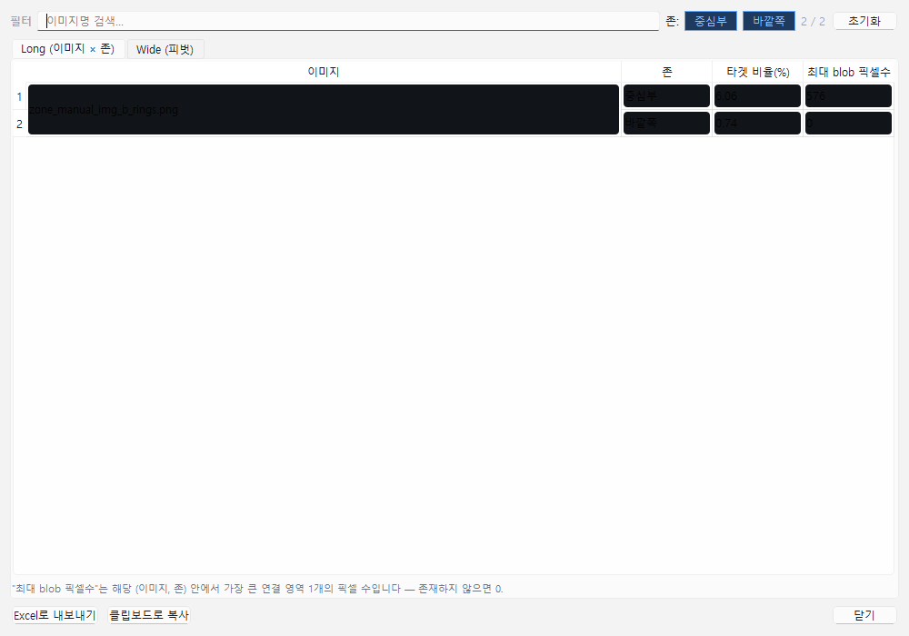

## 다음 이미지로 이동 / 배치 처리

이미지 목록에서 다른 이미지를 클릭하면 전환된다. **전환 직전 현재 이미지의 원·브러시·블랍삭제 상태는 자동으로 사이드카 파일(`{이미지명}.zone.json`)에 저장되고, 다시 그 이미지로 돌아오면 그대로 복원된다.**

2장 이상 + 기준 이미지에 원이 1개 이상 있으면 좌측 "Zone 결정 방법" 콤보에서 **일괄 적용**(기준 이미지의 원을 전체에 스케일 적용) / **일괄 적용 후 수정** / **장별 적용**(이미지마다 개별 자동검출) 중 고르고 **"선택 이미지 일괄 처리"**로 여러 이미지를 한 번에 처리한다.

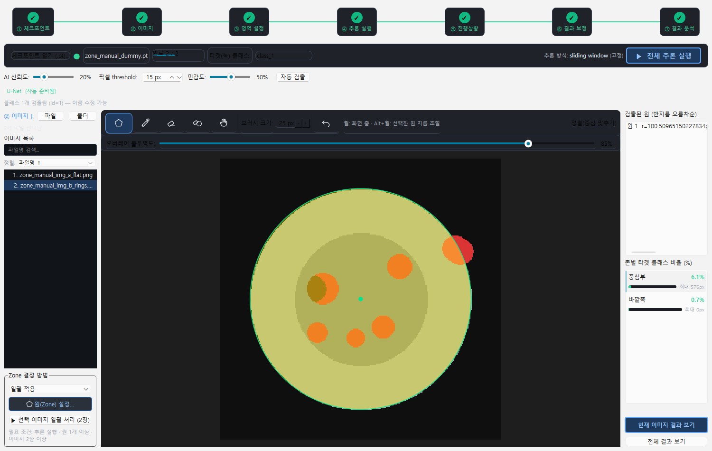

이미 Zone 편집 이력(사이드카)이 있는 이미지가 섞여 있으면 어떻게 할지 확인한다.

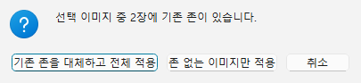

처리가 끝나면 전체 이미지의 존별 결과 표가 자동으로 뜬다.

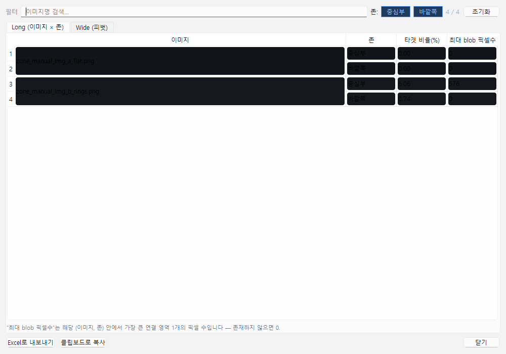

## 전체 흐름

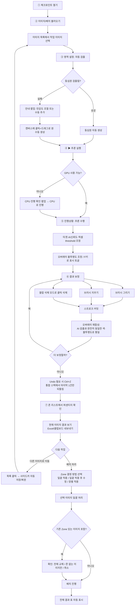

## 추천 파라미터 / 설정

| 항목 | 코드 기본값 | 실무 권장값 | 비고 |
|---|---|---|---|
| AI 신뢰도(min_confidence) | 0% | 처음엔 0%로 전체 검출을 본 뒤, 노이즈성 오탐이 많으면 10~30%까지 점진적으로 올림 | 재추론 없이 즉시 반영(numpy 재계산만) |
| 픽셀 threshold(min_pixel_size) | 0px | 카메라 해상도·결함 최소 크기에 맞춰 5~30px — 너무 크게 잡으면 실제 미세 녹까지 걸러짐 | 재추론 없이 즉시 반영 |
| 원(Zone) 자동검출 민감도 | 50% | 금속광택·그림자 심한 이미지는 60~80%로 올려 약한 edge도 후보에 포함, 배경이 깔끔하면 30~40%로 낮춰 오검출 억제 | 0.0(엄격)~1.0(관대) |
| 오버레이 불투명도 | 50% | 꼼꼼히 볼 땐 70~90%(경계 뚜렷), 원본과 겹쳐볼 땐 30~40% | 이미지 전환·재추론에도 세션 내 값 유지 |
| 브러시 크기(존 탭 전용 기본값) | 30px | 큰 영역 일괄 보정은 40~60px, 작은 녹 반점의 정밀 보정은 10~20px | 1~200px 범위, 그리기/지우기 공용 |
| Zone 결정 방법(배치) | 일괄 적용(콤보 1번째) | 같은 각도·같은 캡 위치로 촬영된 세트는 "일괄 적용", 각도 편차가 크면 "장별 적용" | "일괄 적용 후 수정"은 기준 원을 베이스로 이미지별 미세조정이 필요할 때 |

---

# 4. R Analysis 탭

> edition 브랜치(`feature/zone-analysis-tab`) 전용 기능.

R 분석(R Analysis) 탭은 AI 모델이 아니라 **고전적 영상처리(CV)** 방식으로 동작하는 독립 도구다. 지정한 ROI(사각형) 영역을 이미지에서 잘라낸 뒤 그레이스케일로 바꾸고, threshold(임계값)로 이진화한 다음 `cv2.findContours`로 윤곽(contour)을 모두 찾아 그 면적을 합산한다(`app/core/r_analysis_metrics.py`의 `detect_contour_mask`). 여러 이미지를 하나의 "셀(cell)"로 묶어 셀 단위로 면적 합계를 분모와 비교해 R값과 PASS/FAIL을 계산하며, 이미지별 개별 판정은 만들지 않는다.

## 전체 흐름

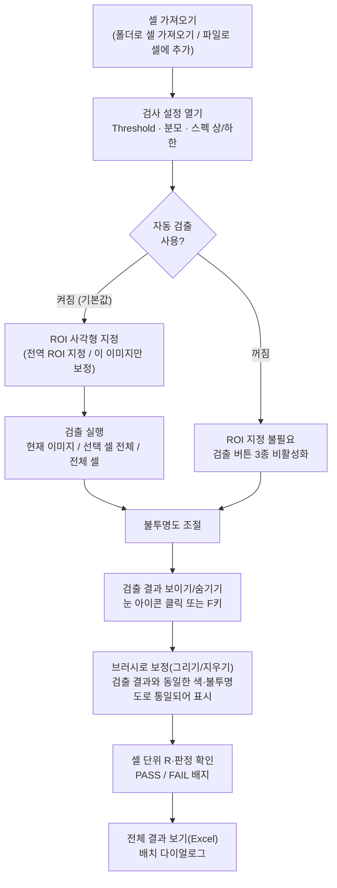

## 1단계 · 셀(이미지 묶음) 불러오기

R 분석은 프로젝트 시스템을 쓰지 않는 완전 독립 도구다. 좌측 패널의 **"폴더로 셀 가져오기"** 버튼을 누르면 바로 아래 하위 폴더명이 각각 셀 ID가 되어 한 번에 여러 셀을 등록할 수 있고, **"파일로 셀에 추가"** 로 개별 파일을 기존/신규 셀에 수동 추가할 수도 있다. 셀을 선택하면 그 셀에 속한 이미지 목록과 썸네일 스트립이 나타난다.

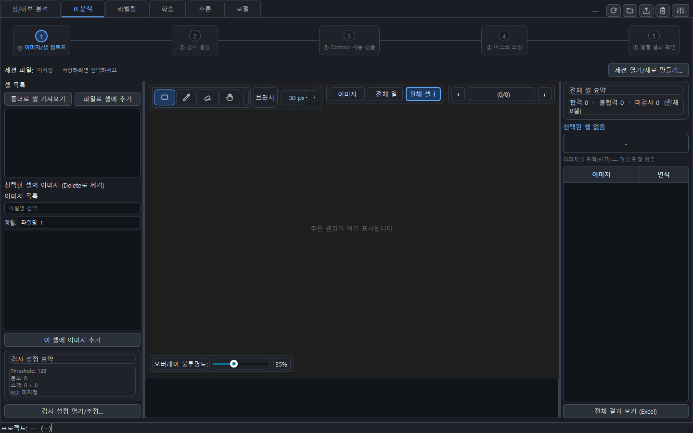

## 2단계 · 검사 설정 — Threshold / 분모 / 스펙 / 자동 검출 on-off

좌측 하단 **"검사 설정 열기/조정..."** 을 누르면 팝업이 뜬다. Threshold 슬라이더는 조정 중 150ms 디바운스 후에만 재검출이 실행되어 드래그 중 매 프레임 재계산하지 않는다. 여기서 **"자동 검출 사용"** 체크박스로 이후 흐름이 갈린다 — 켜져 있으면 ROI+threshold+contour 자동 검출을 쓰고, 끄면 자동 검출을 완전히 건너뛰고 사용자가 브러시로 그린 영역만 면적으로 집계한다(ROI 지정 자체가 필요 없어짐).

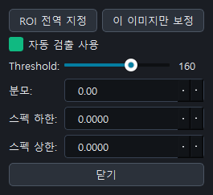

## 3단계 · ROI(검사 영역) 사각형 지정 — 자동 검출 켜짐일 때만

캔버스 상단 툴바의 네모박스 아이콘(ROI 도구, 기본 선택)이 활성화된 상태에서 캔버스를 드래그하면 사각형 ROI를 만들 수 있다. 생성 후에도 8개 핸들로 이동/리사이즈가 가능하다.

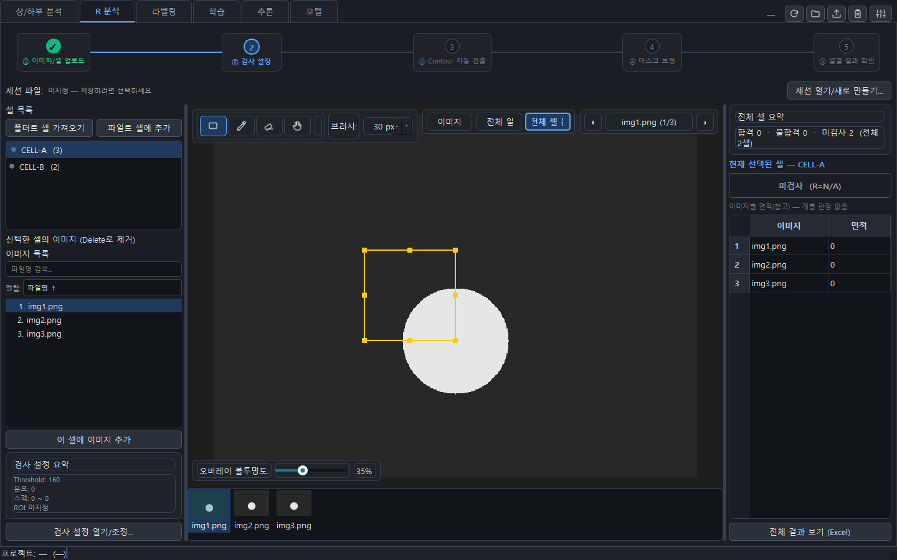

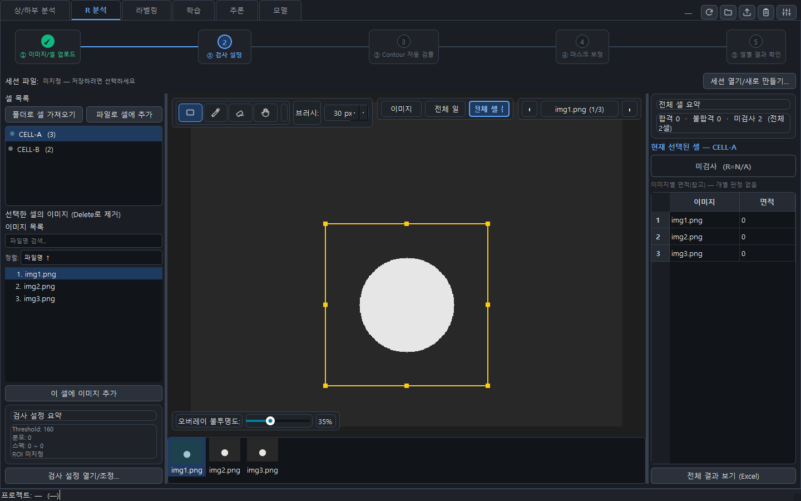

캔버스에 그린 ROI는 드래그만으로는 저장되지 않는다. 검사 설정 패널의 **"ROI 전역 지정"**(모든 셀 공통) 또는 **"이 이미지만 보정"**(현재 이미지 전용 override) 버튼을 눌러야 세션에 커밋되고, 커밋 즉시 재검출이 실행된다.

## 4단계 · 검출 실행 + 결과 확인

캔버스 상단 중앙의 **"현재 이미지 검출" / "선택 셀 전체 일괄 검출" / "▶ 전체 셀 분석"** 3개 버튼 중 범위에 맞는 것을 누르면 검출 마스크(녹색)가 ROI 안에서 그려진다. 자동 검출이 꺼지면 이 3개 버튼은 비활성화된다.

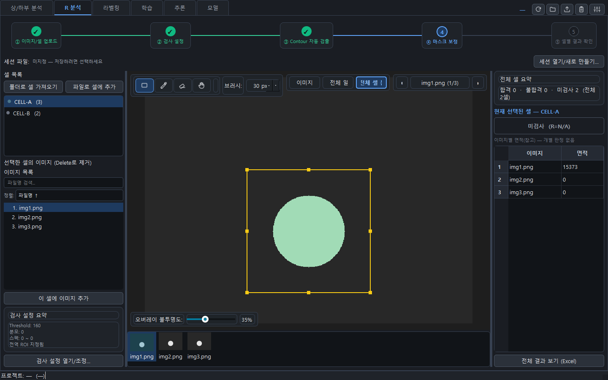

## 5단계 · 불투명도 조절

캔버스 좌하단의 "오버레이 불투명도" 슬라이더로 마스크 표시 강도를 0~100% 사이에서 실시간 조절한다(디바운스 없음 — 메모리 내 재렌더링뿐이라 가볍다).

## 6단계 · 결과 보이기/숨기기

툴바 우측의 눈 아이콘을 클릭하거나 캔버스에 포커스가 있을 때 **F키**를 누르면 검출 결과 오버레이를 껐다 켤 수 있다. 데이터(면적 계산)에는 영향이 없는 순수 표시 토글이다.

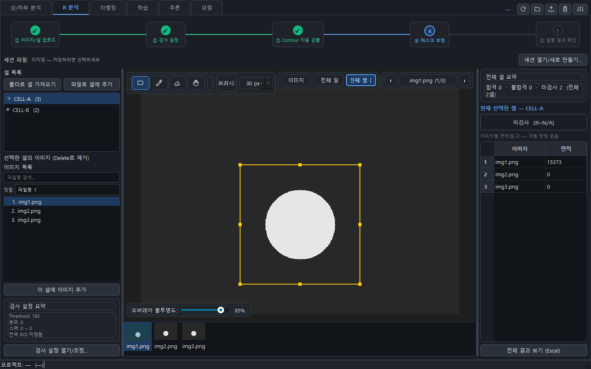

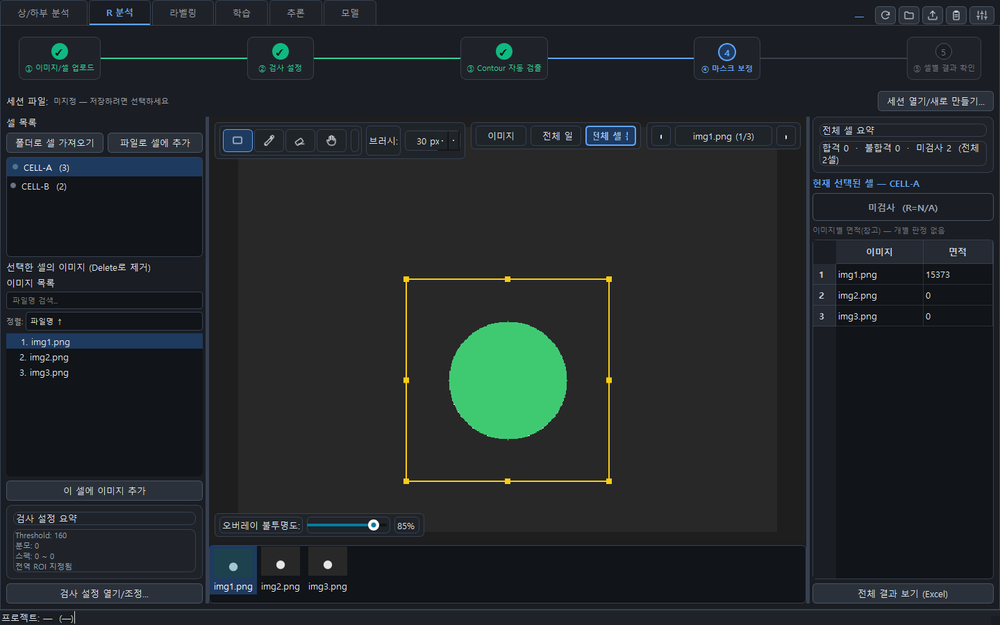

## 7단계 · 브러시로 보정

브러시(그리기)/지우개 도구로 자동 검출이 놓친 부분을 추가하거나 과검출된 부분을 지울 수 있다. **핵심 설계 원칙**: 브러시로 커밋한 영역은 검출 마스크와 완전히 동일한 색(초록)·동일한 불투명도로 통일되어 보인다 — 별도의 색으로 덧씌워 "보정 흔적"이 남지 않는다. 스트로크를 끝내는 즉시(erase_changed) 면적이 재계산된다.

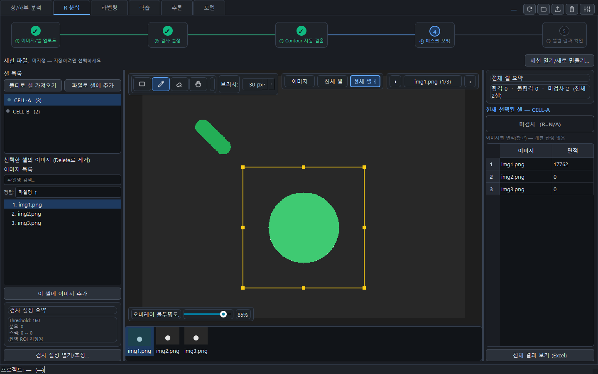

## 8단계 · 자동 검출 OFF 분기 — ROI 없이 브러시만으로 영역 지정

검사 설정에서 "자동 검출 사용"을 끄면 ROI가 전혀 없어도(또는 전역 ROI가 설정돼 있어도 무시하고) 자동 검출을 전혀 수행하지 않는다. 오직 브러시로 그린 영역만 면적으로 집계된다 — 조명이 고르지 않거나 threshold로 깨끗하게 분리되지 않는 이미지에서 전부 수동으로 검사 영역을 지정할 때 쓴다.

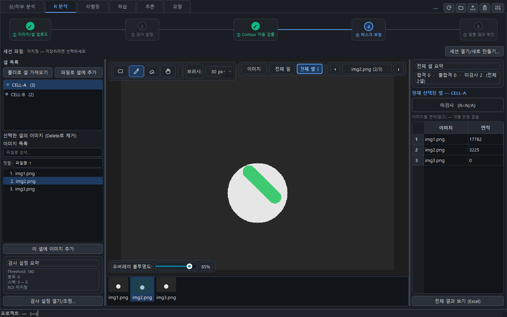

## 9단계 · 셀 단위 R·판정 확인

셀 안의 모든 이미지 면적을 합산해 `R = 면적합계 / 분모`를 셀당 1번만 계산하고, 스펙 상/하한과 비교해 PASS/FAIL 배지를 보여준다. 이미지별 개별 판정은 없다 — 우측 패널 표는 "참고용" 이미지별 면적만 보여준다. 전체 셀 요약 줄에서 합격/불합격/미검사 개수도 한눈에 볼 수 있다.

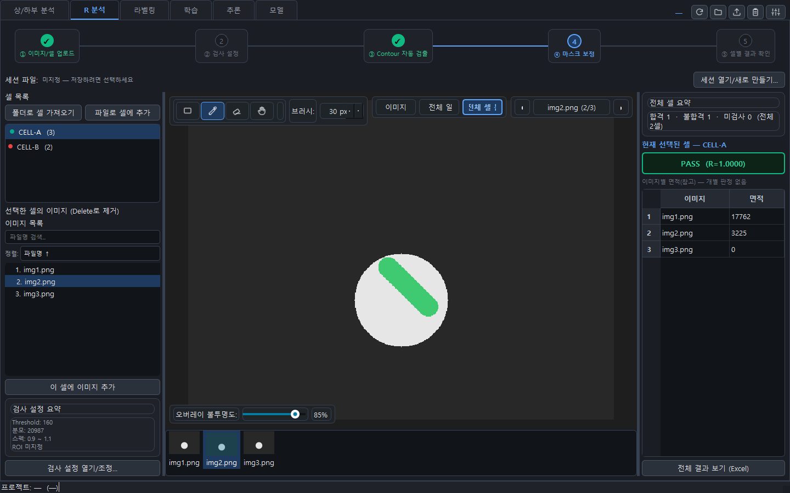

## 10단계 · 전체 결과 보기(Excel 내보내기)

우측 패널 하단 **"전체 결과 보기 (Excel)"** 버튼을 누르면 모든 셀의 요약(셀 탭)과 이미지별 참고 데이터(이미지별 탭)를 담은 다이얼로그가 뜨고, 여기서 `.xlsx`로 바로 내보낼 수 있다.

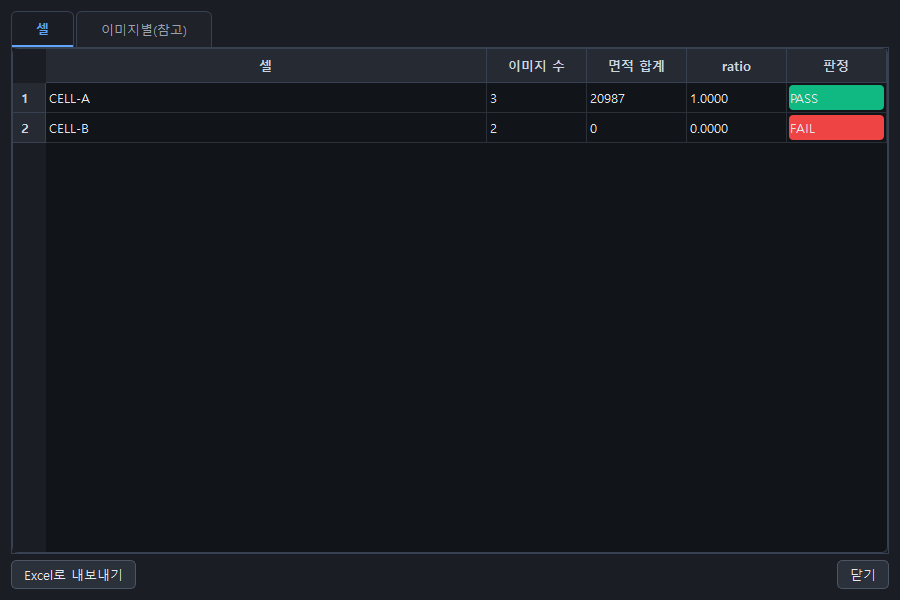

## 추천 파라미터 / 설정

| 항목 | 코드 기본값 | 권장 사용 시나리오 |
|---|---|---|
| Threshold | **128** (0~255 슬라이더) | 기본값에서 시작해 "현재 이미지 검출"로 먼저 확인. 배경이 밝고 타겟(녹)이 상대적으로 어두우면 낮추고, 배경이 어둡고 타겟이 밝으면 기본값 또는 높여서 분리. 배치 검출 전에 반드시 대표 이미지 1~2장으로 값을 확정할 것 |
| 분모(denominator) | **0.0** | 0이면 ratio가 계산되지 않고(N/A) 모든 셀이 "미검사"로 표시됨 — 검사를 시작하기 전 반드시 실제 기준값(예: 기준 면적, 전체 캡 면적 등)으로 설정 |
| 스펙 하한/상한 | **0.0 / 0.0** | 분모와 마찬가지로 설정 전엔 사실상 의미 없음(0~0 범위라 R=0만 PASS). 실제 불량 기준(R비율)에 맞춰 조정 |
| 자동 검출(auto_detect) | **켜짐(True)** | **켜짐**: 녹/부식처럼 배경과 밝기 대비가 뚜렷해 threshold+contour로 안정적으로 분리되는 경우 — ROI 1개로 여러 셀을 일괄·고속 처리 가능. **꺼짐**: 조명이 불균일하거나 threshold로 깨끗이 안 갈라지는 이미지, 또는 검사 영역이 사각형 ROI로 표현하기 어려운 불규칙한 형태일 때 — ROI 지정 없이 전부 브러시로 수동 지정 |
| 오버레이 불투명도 | **90/255 ≈ 35%** | 기본값은 이미지 원본과 마스크를 동시에 보기 좋은 절충점. 브러시로 경계를 세밀하게 보정할 때는 70~90%로 올려 마스크 윤곽을 뚜렷하게, 이미지 자체 디테일을 확인할 때는 20% 이하로 내리길 권장 |
| 브러시 크기 | **30px** (공용 기본값 20px에서 R 탭 전용 override) | 큰 영역 보정 시 40~60px로 키우고, 경계 미세 보정 시 10~15px로 줄이는 식으로 상황별 조정 |
| 최소 contour 면적 | **4.0px²** (코드 상수, UI 미노출) | 1px 수준의 이진화 노이즈 제거용 고정값 |

---

## 스크린샷 출처

| 탭 | 폴더 |
|---|---|
| 학습 | `screenshots/training/` |
| 추론 | `screenshots/inference/` |
| Top/Bottom 분석 | `screenshots/zone/` |
| R 분석 | `screenshots/r_analysis/` |

모든 스크린샷은 오프스크린 렌더링이 아니라 실제 Qt 플랫폼(기본값)으로 앱을 띄워, `QTest`로 실제 위젯에 클릭/드래그/키 입력을 보내 캡처했다(합성 테스트 이미지·임시 체크포인트 사용, 프로덕션 코드는 수정하지 않음).
